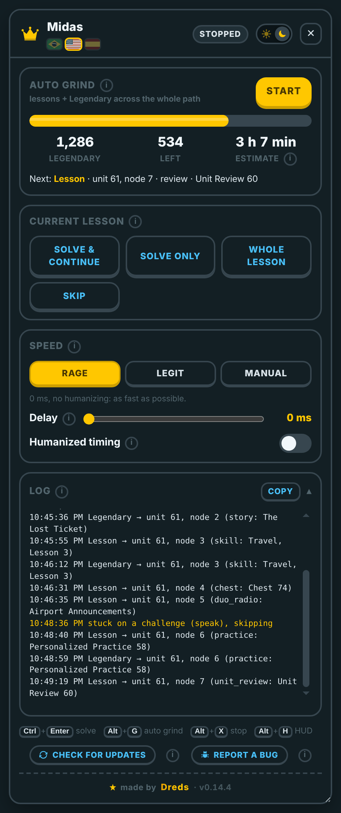
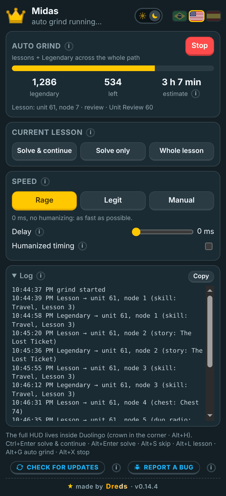
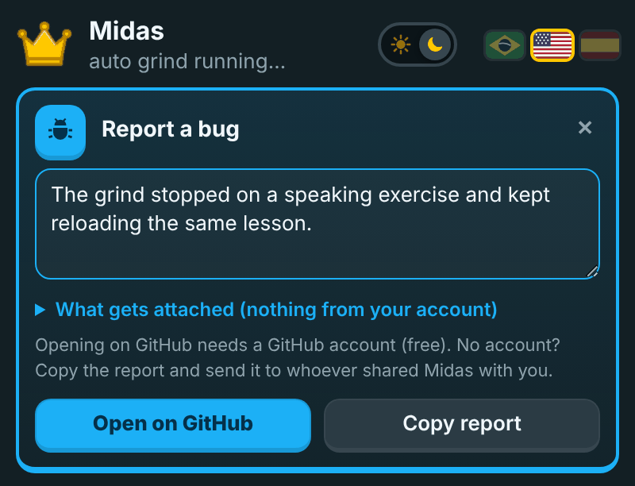

<div align="center">


# Midas

**Everything it touches turns to gold.**
A Chrome extension (Manifest V3) that solves Duolingo lessons and stories and runs an **Auto Grind** that takes every node on your path to Legendary.




</div>

---

## What it does

- **Auto Grind (“Gild everything”).** Reads your whole learning path, finishes the lessons you haven't done, then runs Legendary on every `skill`, `story` and `practice` node, from the first unit to the last (Spaced Repetition practices included: Midas fills in the skill list the Duolingo website leaves empty). It checks that each node really turned legendary and retries once. It stops on its own when nothing is left, or when you press **Stop**. It is built to run unattended:
  - if the tab reloads mid-run, it picks up where it stopped; it also reloads the page by itself every hour (between nodes) and whenever the path gets stuck;
  - if the next lesson node doesn't show up on the page (it happens in background tabs), it opens the lesson by its direct address; if the page shows a different node as active (another tab moved the course on), it reloads once to get a fresh path;
  - a speaking exercise that can't be skipped makes it leave the lesson and reload; after 3 tries on the same node it moves on and comes back at the hourly restart;
  - a background watchdog reloads the tab right away if Chrome's Energy Saver freezes it, or after 4 minutes if the page hangs;
  - only one Duolingo tab grinds at a time, and when Duolingo asks for a streak goal it picks the highest one.
- **Lesson solver.** 35+ challenge types (translate, match, tap/cloze, listen, select, complete, order…), plus a generic fallback that logs any new type it meets so it can be added.
- **Story solver.** Multiple choice, select phrase, arrange, gap fill, point-to-phrase and match.
- **In-page HUD.** A gold crown in the corner of Duolingo opens a draggable, resizable panel (shadow DOM, Duolingo's own colors) with live progress, current lesson controls, settings and log.
- **Speed presets.** *Rage* (0 ms, as fast as possible), *Legit* (about 2.5 s between actions with human-like variation) or *Manual* (pick your own delay and humanizing).
- **PT / EN / ES** and **light / dark** themes, shared between the HUD and the popup. The first run follows the browser language (anything other than Portuguese or Spanish falls back to English); the flags in the HUD and popup header switch it.
- **First-run tutorial and what's new.** A 5-step tutorial on first install, *What's new in vX.Y.Z* once per version (skipping versions shows every change in between), and *New version vX.Y.Z* with a summary and an **Update** button. They show up by themselves as a box at the bottom center of the Duolingo page (it never covers the next node on the path), with no dark overlay, so the site stays clickable and a running grind isn't affected. **?** in the HUD and popup header reopens the tutorial.
- **Report a bug.** A bug button next to *Check for updates* (HUD and popup) opens a card where you describe what happened. It attaches a diagnostic with no account data (version, browser, grind state and speed, current node, progress, recent log lines, never your user, e-mail, token or cookies) and opens a prefilled GitHub issue, or copies the full report to paste anywhere.

<p align="center">
  
  &nbsp;
  
</p>

### Hotkeys

| Key | Action |
|---|---|
| `Ctrl+Enter` | solve and continue |
| `Alt+Enter` | solve only |
| `Alt+S` | skip challenge |
| `Alt+L` | solve the whole lesson / story |
| `Alt+G` | toggle Auto Grind |
| `Alt+X` | stop |
| `Alt+H` | show / hide the HUD |

## Install

Works on **Chrome, Edge, Brave, Opera GX** and **Firefox 140+** (one package for all of them).

**Chrome, Edge, Brave, Opera GX**

1. Download **midas-vX.Y.Z.zip** from the [latest release](https://github.com/DredsGG/midas/releases/latest) and extract it to a folder you'll keep (e.g. `Documents\Midas`). Don't move or delete it later: the browser loads the extension from it.
2. Open **`COMO-INSTALAR.html`** in that folder for the illustrated guide (Portuguese, English, Spanish), or:
3. Open the extensions page (`chrome://extensions`, `edge://extensions`, `brave://extensions` or `opera://extensions`), turn on **Developer mode**, click **Load unpacked** and pick the folder that has `manifest.json`. From a clone of this repo, load the `extension/` folder.
4. Open (or reload) duolingo.com.

**Firefox 140+**

- When a release has **midas-vX.Y.Z.xpi** (signed by Mozilla for self-distribution), click it and confirm; it updates itself through [`firefox/updates.json`](firefox/updates.json).
- Without an `.xpi` yet: `about:debugging` → *This Firefox* → *Load Temporary Add-on* → pick `manifest.json` in the unzipped folder (it's removed when Firefox closes).

Keep Duolingo in its **own visible window** while grinding: Chrome throttles timers in background tabs and the grind slows down a lot. If Chrome's **Energy Saver** is on (Settings → Performance), it can freeze a background Duolingo tab; Midas reloads it and carries on, but turning Energy Saver off avoids the interruptions.

## Updates

While Duolingo is open, Midas checks this repo's releases by itself: when the page opens, every 30 minutes and whenever you come back to the tab (at most once every 10 minutes); **Check for updates** (bottom of the HUD and the popup) is just a backup. When there's a new version, a box shows up right away, without reloading, with what changed (from `extension/src/changelog/`, in your language). The ✕ only postpones it for 1 hour (or until you open the browser again). A release marked **URGENTE** (for a serious bug) shows the box without ✕ and pauses Midas until you update. Click **Update** to download the zip, extract it **over the same folder**, and within a minute Midas notices the new files and reloads itself together with the Duolingo tab; a running Auto Grind keeps going.

## How it's built

```
extension/
├── manifest.json
├── src/main.js        MAIN world: solvers, lesson/story player, grind loop
├── src/hud.js         MAIN world: in-page HUD (closed shadow DOM)
├── src/bridge.js      ISOLATED world: chrome.storage ⇄ page via CustomEvent
├── src/i18n.js        PT / EN / ES strings
├── src/background.js  toolbar badge, update checks, reloads itself when new files land, frozen-tab watchdog
├── COMO-INSTALAR.html install / update guide (PT / EN / ES), guia/guia.js
└── popup/             toolbar popup
```

Plain JavaScript, no build step. A few choices worth pointing out:

- **Small footprint on the page.** Content scripts are declared with `world: "MAIN"`, so there's no injected `<script>` tag, no iframe and no `web_accessible_resources`. Nothing enumerable is added to `window`; shared objects live under `Symbol.for(...)` keys.
- **Answers come from the challenge object Duolingo already loaded**, read through React fiber, not from guessing on the DOM. The "already answered" check is keyed on the identity of that object, which fixed a race where Duolingo swapped challenges faster than the loop tick.
- **Legendary practice nodes** only get credited if their section is loaded first, so the grind loads it before opening the Legendary session.
- **Context-invalidated guard.** After an extension update, an old tab's bridge stops talking to `chrome.*` quietly and the HUD offers a reload, instead of throwing errors.

Measured on a live account: a Legendary skill went 17/17 with no mistakes in about 26 s.

### Known limits

- `speak`, `characterTrace` and `characterWrite` challenges are skipped (in Legendary a skip counts as a mistake).
- Chests on the path are opened by clicking them, so they need the path to be drawn on the page; there is no direct address for them.

## Credits

Midas is my own rewrite. Ideas and the starting point came from the Apache-2.0 [Autolingo](https://github.com/krisl/autolingo) lineage (originally by [2-X / Kris](https://github.com/2-X/autolingo), adapted by [Smint](https://github.com/smintf/autolingo) and [krisl](https://github.com/krisl/autolingo)). See [NOTICE](NOTICE).

## Disclaimer

Personal project, not affiliated with or endorsed by Duolingo. Automating lessons goes against Duolingo's Terms of Service and can get an account flagged or banned. Use it on your own account and at your own risk.

## License

[Apache License 2.0](LICENSE) · made by [André Miller Fleck (Dreds)](https://github.com/DredsGG)
