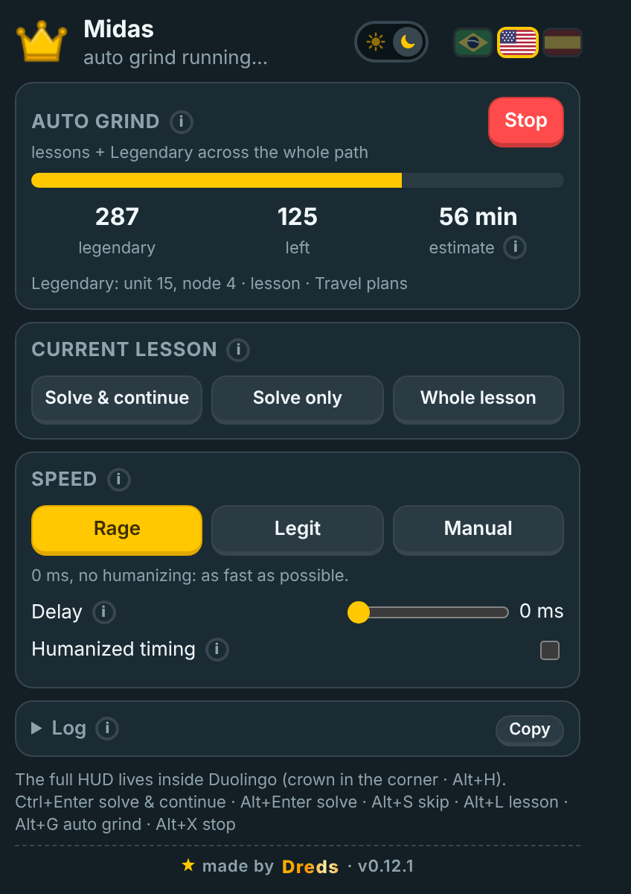

<div align="center">


# Midas

**Everything it touches turns to gold.**
A Chrome extension (Manifest V3) that solves Duolingo lessons and stories and runs an **Auto Grind** that takes every node on your path to Legendary.




</div>

---

## What it does

- **Auto Grind (“Gild everything”).** Reads your whole learning path, finishes the lessons you haven't done, then runs Legendary on every `skill`, `story` and `practice` node, from the first unit to the last. It checks each node actually turned legendary and retries once. It finishes on its own when nothing is left; otherwise it keeps going until you press **Stop**: if the tab reloads mid-run it picks up where it stopped, it reloads the page by itself every hour (between nodes) and whenever the path gets stuck, and only one Duolingo tab grinds at a time. When Duolingo asks for a new streak goal, it picks the highest one.
- **Lesson solver.** 40+ challenge types (translate, match, tap/cloze, listen, select, complete, order…), plus a generic fallback that logs any new type it meets so it can be added.
- **Story solver.** Multiple choice, select phrase, arrange, gap fill, point-to-phrase and match.
- **In-page HUD.** A gold crown in the corner of Duolingo opens a draggable, resizable panel (shadow DOM, Duolingo's own colors) with live progress, current lesson controls, settings and log.
- **Speed presets.** *Rage* (0 ms, as fast as possible), *Legit* (about 2.5 s between actions with human-like variation) or *Manual* (pick your own delay and humanizing).
- **PT / EN / ES** and **light / dark** themes, shared between the HUD and the popup.

### Hotkeys

| Key | Action |
|---|---|
| `Ctrl+Enter` | solve and continue |
| `Alt+Enter` | solve only |
| `Alt+S` | skip challenge |
| `Alt+L` | solve the whole lesson / story |
| `Alt+G` | toggle Auto Grind |
| `Alt+X` | stop |
| `Alt+H` | show / hide the HUD |

## Install

1. Download **midas-vX.Y.Z.zip** from the [latest release](https://github.com/DredsGG/midas/releases/latest) and extract it to a folder you'll keep (e.g. `Documents\Midas`). Don't move or delete it later: Chrome loads the extension from it.
2. Open **`COMO-INSTALAR.html`** in that folder for the illustrated guide (Portuguese, English, Spanish), or:
3. Open `chrome://extensions`, turn on **Developer mode**, click **Load unpacked** and pick the folder that has `manifest.json`. From a clone of this repo, load the `extension/` folder.
4. Open (or reload) duolingo.com.

Keep Duolingo in its **own visible window** while grinding: Chrome throttles timers in background tabs and the grind slows down a lot.

## Updates

Midas checks this repo's releases when Chrome starts, every 6 hours and when you press **Check for updates** (bottom of the HUD and the popup). When there's a new version, a gold card shows what changed. Click **Update** to download the zip, extract it **over the same folder**, and within a minute Midas notices the new files and reloads itself together with the Duolingo tab; a running Auto Grind keeps going.

## How it's built

```
extension/
├── manifest.json
├── src/main.js        MAIN world: solvers, lesson/story player, grind loop
├── src/hud.js         MAIN world: in-page HUD (closed shadow DOM)
├── src/bridge.js      ISOLATED world: chrome.storage ⇄ page via CustomEvent
├── src/i18n.js        PT / EN / ES strings
├── src/background.js  toolbar badge, update checks, reloads itself when new files land
├── COMO-INSTALAR.html install / update guide (PT / EN / ES), guia/guia.js
└── popup/             toolbar popup
```

Plain JavaScript, no build step. A few choices worth pointing out:

- **Small footprint on the page.** Content scripts are declared with `world: "MAIN"`, so there's no injected `<script>` tag, no iframe and no `web_accessible_resources`. Nothing enumerable is added to `window`; shared objects live under `Symbol.for(...)` keys.
- **Answers come from the challenge object Duolingo already loaded**, read through React fiber, not from guessing on the DOM. The "already answered" check is keyed on the identity of that object, which fixed a race where Duolingo swapped challenges faster than the loop tick.
- **Legendary practice nodes** only get credited if their section is loaded first, so the grind loads it before opening the Legendary session.
- **Context-invalidated guard.** After an extension update, an old tab's bridge stops talking to `chrome.*` quietly and the HUD offers a reload, instead of throwing errors.

Measured on a live account: a Legendary skill went 17/17 with no mistakes in about 26 s.

### Known limits

- `speak`, `characterTrace` and `characterWrite` challenges are skipped (in Legendary a skip counts as a mistake).
- Spaced-repetition practice can't be done in Legendary on the web, so it's counted separately.

## Credits

Midas is my own rewrite. Ideas and the starting point came from the Apache-2.0 [Autolingo](https://github.com/krisl/autolingo) lineage (originally by [2-X / Kris](https://github.com/2-X/autolingo), adapted by [Smint](https://github.com/smintf/autolingo) and [krisl](https://github.com/krisl/autolingo)). See [NOTICE](NOTICE).

## Disclaimer

Personal project, not affiliated with or endorsed by Duolingo. Automating lessons goes against Duolingo's Terms of Service and can get an account flagged or banned. Use it on your own account and at your own risk.

## License

[Apache License 2.0](LICENSE) · made by [André Miller Fleck (Dreds)](https://github.com/DredsGG)
